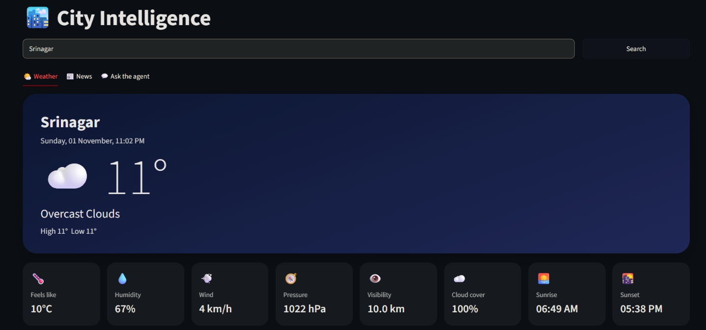
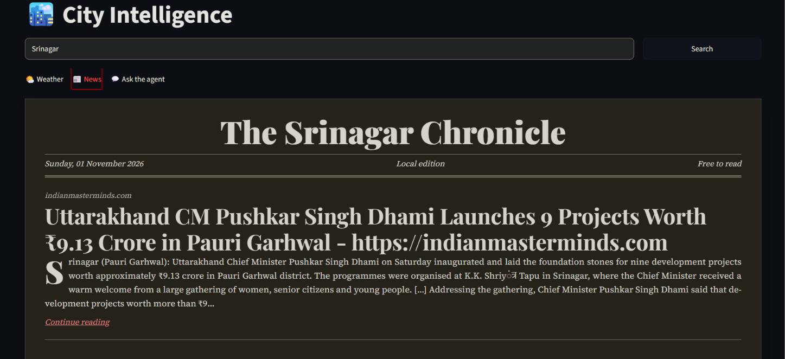

# 🏙️ City Intelligence

A Streamlit app that gives you live **weather** and **local news** for any Indian city, plus an AI agent you can chat with. Weather is shown like a regular weather app, and news is laid out like a newspaper front page.

Built with LangChain, Google Gemini, OpenWeather and Tavily.

## Features

- **Weather dashboard:** current temperature, condition, high and low, feels-like, humidity, wind, pressure, visibility, cloud cover, sunrise and sunset, and a 5-day forecast. The card colour changes with the weather and the time of day.
- **Newspaper-style news:** a front page named after your city, with a lead story and ruled columns. Each headline links to the original article.
- **Chat with the agent:** a Gemini-powered LangChain agent that decides when to call the weather and news tools, and shows which tools it used.
- **Caching:** API results are cached for 10 to 15 minutes to save calls.

## Screenshots

Add your screenshots to a `screenshots/` folder and update the paths below.

| Weather | News |
| --- | --- |
|  |  |

## Tech stack

- [Streamlit](https://streamlit.io/) for the UI
- [LangChain](https://www.langchain.com/) for the agent and tools
- [Google Gemini](https://ai.google.dev/) as the LLM
- [OpenWeather API](https://openweathermap.org/api) for weather and forecast
- [Tavily](https://tavily.com/) for news search

## Getting started

### 1. Clone the repo

```bash
git clone https://github.com/SUNRAKU-007/City-Intelligence.git
cd City-Intelligence
```

### 2. Create a virtual environment (recommended)

```bash
python -m venv venv
```

Activate it:

```bash
# Windows (PowerShell)
venv\Scripts\Activate.ps1

# macOS / Linux
source venv/bin/activate
```

### 3. Install dependencies

```bash
python -m pip install streamlit python-dotenv requests tavily-python langchain langchain-google-genai rich
```

### 4. Add your API keys

Create a file named `.env` in the project folder:

```env
GOOGLE_API_KEY=your_google_gemini_key
OPENWEATHER_API_KEY=your_openweather_key
TAVILY_API_KEY=your_tavily_key
```

Where to get the keys:

| Key | Link |
| --- | --- |
| Google Gemini | https://aistudio.google.com/app/apikey |
| OpenWeather | https://home.openweathermap.org/api_keys |
| Tavily | https://app.tavily.com/ |

> Never commit your `.env` file. It is listed in `.gitignore`.

### 5. Run the app

```bash
python -m streamlit run app.py
```

The app opens at http://localhost:8501.

## How to use

1. Type an Indian city (for example `Srinagar` or `Jalandhar`) and press **Search**.
2. Open the **Weather** tab for the current conditions and forecast.
3. Open the **News** tab for the local front page.
4. Open **Ask the agent** and ask things like *"What's the weather in Delhi and any big news there?"*

## Project structure

```
.
├── app.py          # Streamlit UI, data fetching and agent
├── .env            # API keys (not committed)
├── .gitignore
└── README.md
```

## Notes

- The OpenWeather free tier can take a few minutes to activate a new key.
- The city search is restricted to India (`,IN` is added to the query).
- The model name is set in `get_agent()` in `app.py`. Change it there if you want a different Gemini model.

## Roadmap

- Human approval step before the agent runs a tool
- Hourly forecast chart
- Support for cities outside India

## License

MIT. Add a `LICENSE` file if you want to publish under this license.
